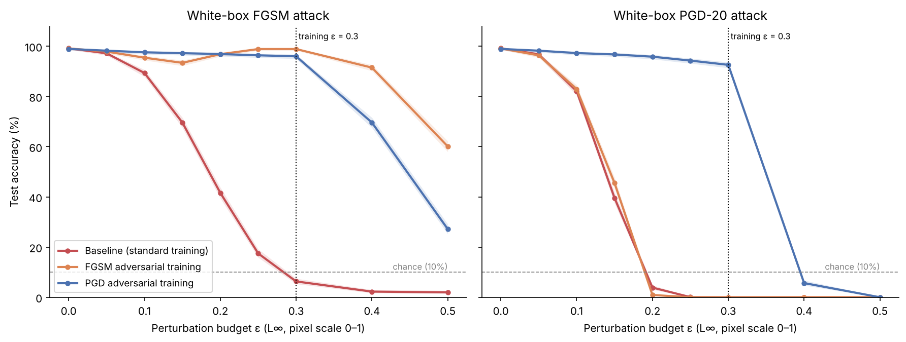

# Adversarial Attacks and Defenses on an MNIST Classifier

A self-contained research mini-project at the intersection of AI engineering
and ML security. It trains a small CNN on MNIST, fools it with **FGSM** and
**PGD** adversarial examples, and evaluates two **adversarial-training
defenses**. The evaluation includes the sanity checks needed to tell real
robustness from gradient masking. Code, results, figures and a written paper
are all included.

| | |
|---|---|
| Paper | [`paper/paper.md`](paper/paper.md) |
| One-command reproduction | `python run_pipeline.py` |
| Results (tables + figures) | [`results/`](results/) |

## Headline results

At the standard MNIST budget **ε = 0.3** (L∞, white-box):

| Model | Clean (10k) | FGSM | PGD-20 | PGD-100 × 5 restarts | Black-box transfer |
|---|---|---|---|---|---|
| Baseline (standard training) | 99.15% | 6.3% | 0.0% | 0.0% | 0.4% |
| FGSM adversarial training | 98.88% | **98.9%** | **0.0%** | 0.0% | 24.9% |
| PGD adversarial training | 98.34% | 96.0% | **92.6%** | **90.2%** | 95.7% |

* **The undefended model is fragile:** PGD lowers its accuracy to 82.2% at
  ε = 0.1, 3.9% at ε = 0.2 and 0.0% at ε = 0.3. The perturbed digits are
  still obvious to a human.
* **FGSM adversarial training is a false defense (gradient masking).** It
  looks almost perfect against FGSM (98.9%), but it has 0% accuracy against
  PGD. It fails every sanity check: FGSM accuracy *rises* with ε, FGSM
  still leaves 60% accuracy at ε = 0.5, and a black-box transfer attack
  (24.9%) beats the white-box FGSM attack. The training log shows the
  collapse ("catastrophic overfitting") within one epoch.
* **PGD adversarial training gives real robustness:** 90.2% under a strong
  PGD-100 attack with 5 restarts, for 0.8 points of clean accuracy and ~5×
  training time. It passes all sanity checks, and its robustness ends where
  its training budget ends (5.7% at ε = 0.4).



See [`paper/paper.md`](paper/paper.md) for the full analysis.

## Companion study: Fashion-MNIST

[`fashion-mnist/`](fashion-mnist/) repeats the attack–defense loop on
**Fashion-MNIST**, a harder dataset, at the ε = 0.1 budget. It has its own
code, pipeline, results and paper
([`fashion-mnist/paper/paper.md`](fashion-mnist/paper/paper.md)). Headline:
the undefended CNN goes from 92.96% clean accuracy to 0.05% under PGD-20.
PGD adversarial training restores 78.25% at a 6.36-point clean-accuracy cost.
FGSM training *with a random start* (Wong et al., 2020) reaches 74.59% and
does not catastrophically overfit at this budget. All of these models fall
below 12% at ε = 0.15.

## Setup

Python ≥ 3.10 (tested on 3.13). CPU only; no GPU needed.

```bash
python -m venv .venv
```

```bash
source .venv/bin/activate
```

```bash
pip install -r requirements.txt
```

MNIST (~11 MB) is downloaded automatically by torchvision into `data/` on
the first run.

## Running

Full experiment (trains 4 models, then runs every attack and figure; ~32 min
on 4 CPU cores):

```bash
python run_pipeline.py
```

Re-run only the evaluation and figures from the committed checkpoints in
`results/models/` (skips training):

```bash
python run_pipeline.py --reuse-models
```

A ~3-minute smoke test with tiny settings (numbers are not meaningful):

```bash
python run_pipeline.py --quick --out results_quick
```

Unit tests:

```bash
python -m unittest discover -s tests -v
```

Options: `--seed` (default 42), `--threads` (default 4), `--out`.

### Reproducibility

All randomness is seeded: weight initialisation, batch order, PGD random
starts and the evaluation subset. `torch.use_deterministic_algorithms(True)`
is enabled. With the same seed, thread count and software versions, every
output file is byte-identical across runs. This was verified by hashing
`results/` over two full runs, and two quick runs. The only exception is
`results/timings.json`, which records wall-clock times. Different CPUs,
thread counts or PyTorch versions can change floating-point summation order
and therefore the exact numbers, but not the conclusions.

## Project layout

```
run_pipeline.py              one entry point that regenerates results/
src/advrobust/
  data.py                    MNIST loading (pixels in [0,1]), seeding
  model.py                   SmallCNN (225k parameters)
  attacks.py                 FGSM and PGD (L∞, random start, restarts)
  train.py                   standard, FGSM-adversarial and PGD-adversarial training
  evaluate.py                ε sweeps, Wilson CIs, white-box and transfer evaluation
  plots.py                   all figures
  pipeline.py                orchestrates the experiment (Config dataclass)
tests/test_attacks.py        unit tests (ε-ball constraints, restarts, training loop, ...)
results/                     CSV/JSON tables, figures/, models/ (checkpoints)
paper/paper.md               the research paper
```

### Outputs in `results/`

| File | Contents |
|---|---|
| `metrics.csv` | Long format: model × attack × ε → accuracy, 95% Wilson CI, n |
| `accuracy_table.csv` | The same as a wide table (one column per ε) |
| `summary_table.csv` | Before/after-defense table: clean, FGSM, PGD, strong PGD, transfer accuracy per model |
| `strong_attack_check.csv` | PGD-20 vs PGD-100 with 5 random restarts at ε = 0.3 |
| `transfer_attack.csv` | Black-box transfer from an independently trained surrogate |
| `training_log.csv` | Per-epoch loss, clean accuracy, monitored FGSM/PGD accuracy |
| `metrics.json` | Machine-readable summary incl. configuration |
| `timings.json` | Wall-clock times (machine-dependent) |
| `models/*.pt` | Trained weights (baseline, surrogate, FGSM-AT, PGD-AT) |
| `figures/accuracy_vs_epsilon.png` | Accuracy-vs-ε curves for FGSM and PGD, all models |
| `figures/adversarial_examples.png` | Original vs FGSM vs PGD images with predicted labels |
| `figures/defense_examples.png` | Same digits attacked before vs after the defense |
| `figures/before_after_defense.png` | Bar chart comparing all models under every evaluation |
| `figures/training_curves.png` | Clean and adversarial accuracy during training |

## Design choices

* **Dataset: MNIST.** It ships with torchvision, trains in seconds, and is the
  standard benchmark for L∞ robustness at ε = 0.3 (Madry et al., 2018), so
  results can be compared with the literature. Pixels are kept in [0, 1]
  with no normalisation, so ε means exactly "each pixel may change by at
  most ε" and the valid-image constraint is the box [0, 1].
* **Model: a small CNN** (2 conv + 2 FC layers, 225k parameters). Standard
  training takes ~1.5 min on 4 CPU cores. It is smaller than Madry et al.'s
  network, which limits attainable robustness; the paper discusses this.
* **Attacks.** *FGSM*, a single gradient-sign step, cheap and the
  historical baseline. *PGD*: 20 iterated steps with random start and
  projection, step size 2.5·ε/steps, the standard "first-order adversary".
  PGD is the attack to trust; FGSM is mainly reported to show how
  misleading a weak attack can be.
* **Defenses.**
  1. *FGSM adversarial training* (Goodfellow et al., 2015): 50/50 clean +
     FGSM loss. Cheap (2× a standard step), and included because it is a
     known trap: it can learn to defeat the single-step attack without
     becoming robust (gradient masking).
  2. *PGD adversarial training* (Madry et al., 2018): train only on 7-step
     PGD examples at ε = 0.3 (8× cost). This is the main defense.
  Both ramp ε linearly from 0 to 0.3 during the first epoch (a standard
  warm-up so the small network does not stall at chance accuracy).
* **Evaluation protocol.** Clean accuracy uses the full 10k test set. Attack
  sweeps use a fixed random subset of 2,000 test images, for compute reasons,
  and every number has a 95% Wilson confidence interval (about ±1–2
  percentage points). Following Carlini et al. (2019) and Athalye et al.
  (2018), we check that:
  PGD ≤ FGSM accuracy; accuracy → 0 as ε grows (ε up to 0.5); a 5× stronger
  attack (PGD-100 with 5 random restarts) does not reveal a hidden collapse;
  and black-box transfer attacks are weaker than white-box ones.

## Threat model and assumptions

* **Goal:** untargeted evasion at test time. The attacker wants *any* wrong
  label for a given test image.
* **Knowledge:** white-box. The attacker knows the architecture and weights
  and can compute gradients; this is the strongest standard setting. A
  black-box setting is also evaluated via transfer from a surrogate model
  trained independently on the same data.
* **Capability:** each pixel may change by at most ε (L∞ ≤ ε) and the image
  must stay in [0, 1]. Headline numbers use ε = 0.3, the MNIST convention.
  On MNIST this is a large change: 30% of the full intensity range on every
  pixel.
* **Out of scope:** other norms (L2, L0/sparse patches), spatial transforms
  (rotation, translation), physical-world attacks, training-time attacks
  (poisoning, backdoors), and adaptive attacks against stochastic or
  non-differentiable defenses. The defenses here are deterministic and fully
  differentiable, so gradient-based PGD is an appropriate adaptive attack.
  Robustness under one threat model does not imply robustness under another.
* **What the guarantees are:** none. Empirical robustness against PGD is a
  lower bound on attack success, not a certificate. A stronger attack
  could lower the reported accuracies. The strong-attack check bounds how
  much that is likely to matter here.

## License

Code is provided for research and education.
