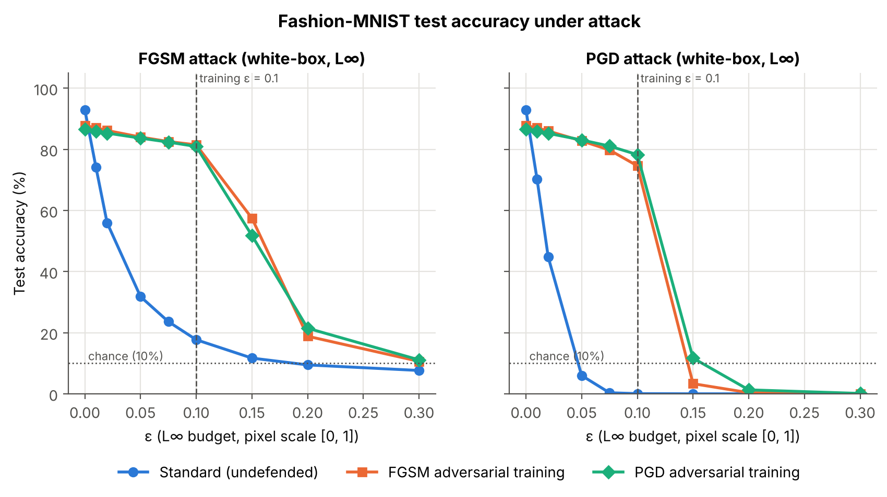
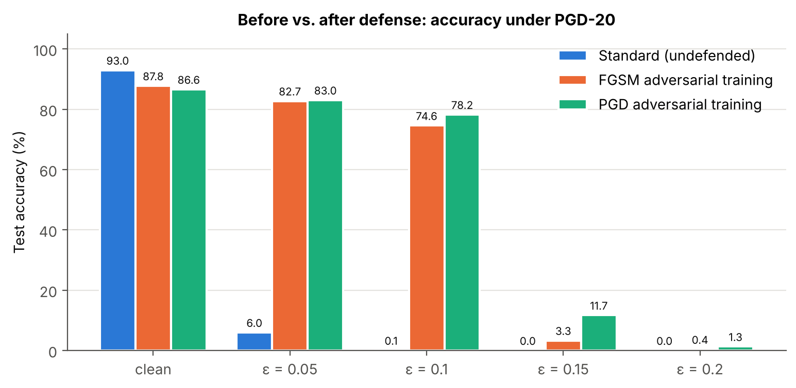
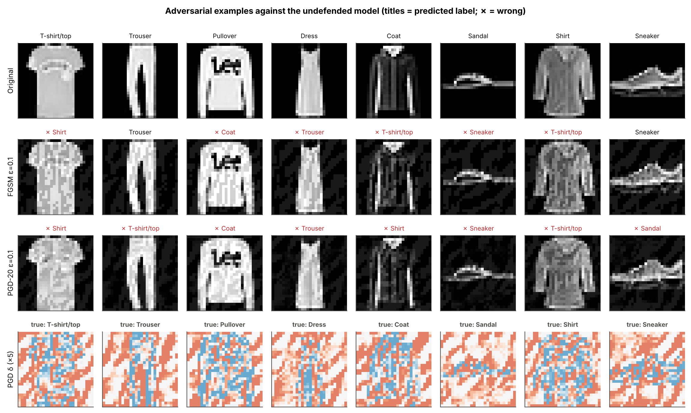
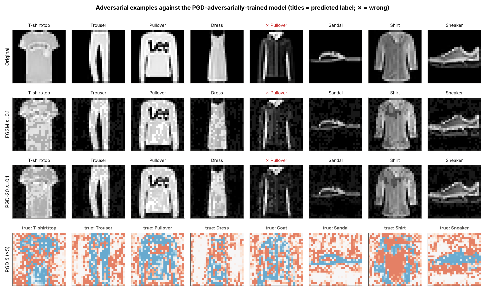

# Adversarial Attacks and Defenses on a Small Image Classifier (Fashion-MNIST)

> Companion study to the MNIST project at the repository root. It is
> self-contained: run every command below from inside this `fashion-mnist/`
> folder (`cd fashion-mnist`).

A small, fully reproducible research project. It trains a CNN on
**Fashion-MNIST**, attacks it with **FGSM** and **PGD** across a range of
perturbation budgets, defends it with **adversarial training** (single-step
"fast" FGSM training and multi-step PGD training), and checks that the measured
robustness is real rather than an artefact of gradient masking.

The write-up is in [`paper/paper.md`](paper/paper.md). All numbers and figures
in it come from the committed files in [`results/`](results/), which
`run_pipeline.py` regenerates.

## Results at a glance

Full-test-set (10,000 images) accuracy, white-box L∞ attacks, ε on the [0, 1]
pixel scale. Both defenses are trained at ε = 0.1. Source:
[`results/metrics_table.csv`](results/metrics_table.csv).

| Model | Clean | FGSM ε=0.05 | FGSM ε=0.1 | PGD-20 ε=0.05 | **PGD-20 ε=0.1** | PGD-20 ε=0.15 | Train time |
|---|---:|---:|---:|---:|---:|---:|---:|
| Standard (undefended) | **92.96%** | 31.79% | 17.69% | 5.97% | **0.05%** | 0.00% | 4.3 min |
| FGSM adversarial training | 87.77% | 84.00% | 81.45% | 82.74% | **74.59%** | 3.31% | 7.7 min |
| PGD adversarial training | 86.60% | 83.65% | 80.92% | 83.05% | **78.25%** | 11.68% | 28.3 min |

* The undefended CNN drops below 50% accuracy at ε = 0.02 (≈ 5/255) under
  PGD. At ε = 0.1, only 5 of 10,000 test images are still classified correctly.
* PGD adversarial training restores **78.25%** accuracy under PGD at ε = 0.1,
  for a 6.36-point clean-accuracy cost and ~7× the training compute.
* Fast FGSM adversarial training gets 95% of that robustness at ~1.9× compute.
  It is weaker against multi-step attacks and beyond the training budget.
* Gradient-masking checks pass. PGD accuracy plateaus from 20 to 100
  iterations (79.8% → 79.3%), random restarts change it by ~1 point, and
  black-box transfer attacks are weaker than white-box ones.
* Robustness does **not** extend past the training budget: PGD-AT falls to
  11.68% at ε = 0.15.

| | |
|---|---|
|  |  |
|  |  |


---

## Folder layout

```
fashion-mnist/
├── run_pipeline.py          # single entry point: train → attack → defend → evaluate → plot
├── requirements.txt
├── src/advlab/
│   ├── config.py            # every hyper-parameter, in one dataclass
│   ├── data.py              # Fashion-MNIST → in-memory [0,1] tensors
│   ├── model.py             # SmallCNN (≈468k params), normalisation inside the model
│   ├── attacks.py           # FGSM and L∞ PGD (random start, restarts)
│   ├── training.py          # standard / FGSM-AT / PGD-AT training loops
│   ├── evaluation.py        # robust accuracy, ε sweep, PGD-convergence, transfer
│   ├── plotting.py          # all figures
│   └── utils.py             # seeding, timing, CSV/JSON helpers
├── tests/test_attacks.py    # unit tests (budget, clipping, determinism, …)
├── results/                 # CSV/JSON metrics + figures (committed)
└── paper/paper.md           # the research paper
```

## Quick start

```bash
pip install -r requirements.txt
```

```bash
python -m pytest -q
```

```bash
python run_pipeline.py --quick
```

```bash
python run_pipeline.py
```

* `--quick` is a smoke test (1 epoch, 500 test images, ~5 min on CPU). It
  writes to `results_quick/` and does not touch the committed results.
* The full run (10 epochs per model, full 10k test set) took **100 min** on a
  4-core CPU with no GPU. Most of that is PGD adversarial training and the PGD
  evaluation. A CUDA GPU is used automatically if present.
* Checkpoints are saved to `checkpoints/` and reused on re-runs; pass
  `--retrain` to train from scratch. `--plots-only` redraws figures from the CSVs.
* Fashion-MNIST is downloaded by torchvision into `data/` on first run.

### Outputs

| File | Contents |
|---|---|
| `results/metrics_table.csv` | One row per model: clean accuracy and accuracy under FGSM and PGD at each ε (the main table). |
| `results/metrics_long.csv` | Same numbers in long format (`model, attack, epsilon, accuracy, n`). |
| `results/pgd_convergence.csv` | Robust accuracy at ε = 0.1 vs. PGD iterations (1–100), plus PGD-20 with 5 random restarts. |
| `results/transfer_attack.csv` | Accuracy of every model on PGD examples crafted on the undefended model. |
| `results/training_log.csv` | Per-epoch loss, training accuracy, clean test accuracy and time per epoch. |
| `results/run_info.json` | Full config, library versions, hardware and stage timings. |
| `results/figures/*.png` | Accuracy-vs-ε curves, adversarial example grids, before/after-defense bars, PGD-convergence, transfer, training curves. |

---

## Threat model

The question we ask is: *how badly can a small, worst-case, nearly invisible
change to the input degrade the classifier, and how much does a defense help?*

| Aspect | Choice | Why |
|---|---|---|
| **Goal** | Untargeted evasion: any wrong label counts as success. | The standard benchmark setting. It is the easiest goal for the attacker, so it gives the most pessimistic robustness estimate. |
| **Knowledge** | **White-box**: architecture, weights and gradients are known. | The strongest attacker. A defense that holds here also holds against weaker (black-box) attackers. We report a black-box *transfer* attack as well. |
| **Capability** | Perturb the test input only (no training-data poisoning), with ‖x′ − x‖∞ ≤ ε and x′ ∈ [0, 1]. | L∞ bounds the per-pixel change, so the image looks unchanged to a human at small ε. It is the setting used by FGSM, PGD and Madry et al. |
| **Budget** | ε ∈ {0.01, 0.02, 0.05, 0.075, 0.1, 0.15, 0.2, 0.3} on the [0, 1] pixel scale; the defense is trained at ε = 0.1 (≈ 25/255). | Fashion-MNIST has textured, low-contrast classes (shirt vs. T-shirt vs. pullover). ε = 0.3, the usual MNIST budget, is large enough to change the semantic content. ε = 0.1 is the conventional Fashion-MNIST budget, and evaluating far beyond it shows where the defense breaks down. |
| **Out of scope** | Physical-world attacks, L2/L0/patch threat models, query-only black-box attacks, adaptive attacks against a specific defense mechanism, data poisoning, model extraction. | These are discussed as limitations in the paper. |

The **defender** controls training. They know the threat model (L∞, ε = 0.1)
but not the specific test-time perturbation.

## Design choices

* **Dataset: Fashion-MNIST rather than MNIST.** Same size and format, so it
  trains equally fast. But it is not saturated: clean accuracy is ~92 %
  rather than ~99 %, and adversarial training has a visible clean-accuracy
  cost. That makes the robustness/accuracy trade-off measurable.
* **Pixels stay in [0, 1]; normalisation is the model's first layer.** This
  way ε is defined in image space, the [0, 1] clipping is exact, and the
  attacks need no knowledge of the preprocessing.
* **Small CNN without batch-norm or dropout** (4 conv + 2 FC, ≈468k params).
  It trains in ~4.3 min/10 epochs on CPU. Without BN/dropout the model behaves
  the same in train and eval mode, so the inner attack in adversarial training
  sees exactly the function being trained.
* **Same seed, init and data order for all three models.** The only
  difference between them is the training objective.
* **Attacks.** FGSM is one step of size ε. PGD uses a uniform random start,
  step size α = 2.5ε/K and K = 20 iterations at evaluation, which is three
  times the 7 steps used in training, so the defense is not evaluated only
  against its own training attack.
* **Defenses.**
  * *PGD adversarial training* (Madry et al.): 7-step PGD, α = ε/4,
    random start, trained on 100 % adversarial batches. This is the main defense.
  * *Fast FGSM adversarial training* (Wong et al.): random start plus one
    1.25ε FGSM step. It is ~3.8× cheaper per epoch than PGD-AT and is included as a
    cost/benefit comparison.
* **Guarding against gradient masking.** A defense can look robust only
  because it breaks the attacker's gradients (Athalye et al., 2018). We check
  three things: (i) PGD accuracy *plateaus* as iterations go from 1 to 100;
  (ii) 5 random restarts barely change it; (iii) black-box transfer examples
  are *weaker* than white-box ones. We also check that PGD ≤ FGSM accuracy
  throughout and that accuracy reaches ~0 % at large ε.
* **Evaluation set.** All accuracies use the full 10,000-image test set,
  except the PGD-convergence check, which uses the first 1,000 images. A 95 %
  binomial confidence interval on 10k images is at most ±1 percentage point.
  The test set is also logged after each epoch to draw training curves, but it
  is never used for model selection, early stopping or tuning: every model
  trains for a fixed 10 epochs.
* **CPU-first.** Everything is sized to finish in a single cloud session with
  no GPU. See `results/run_info.json` for the exact timings.

## Reproducibility

`run_pipeline.py` seeds Python, NumPy and PyTorch, and passes an explicit RNG
to data shuffling and to every random start. On the same hardware and library
versions, a re-run reproduces the CSVs. Across hardware or BLAS builds,
floating-point non-associativity can move individual accuracies by a few tenths
of a percent. The committed results were produced with the versions listed in
`results/run_info.json`.
