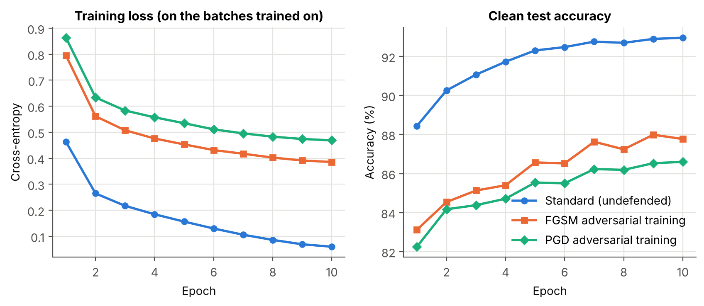
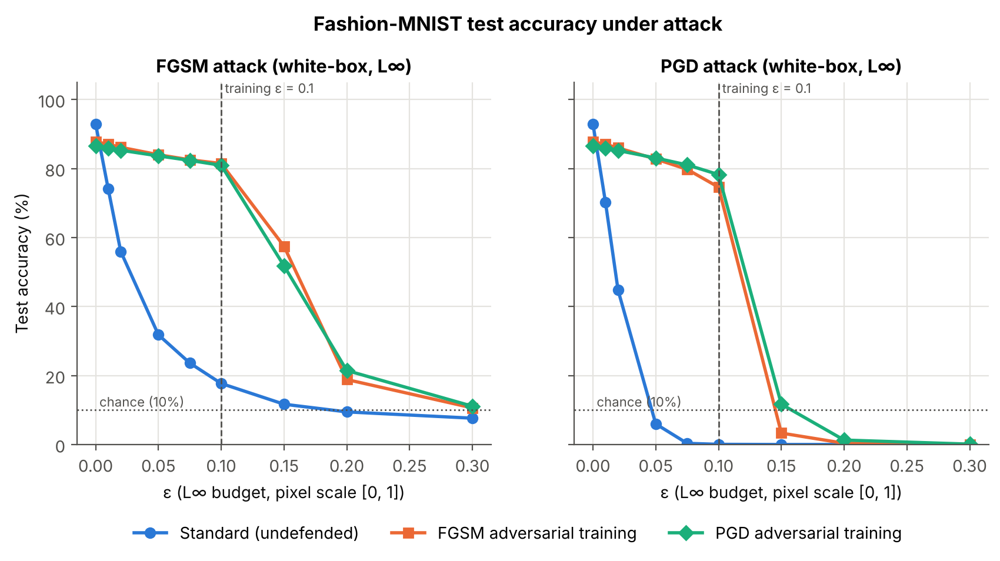
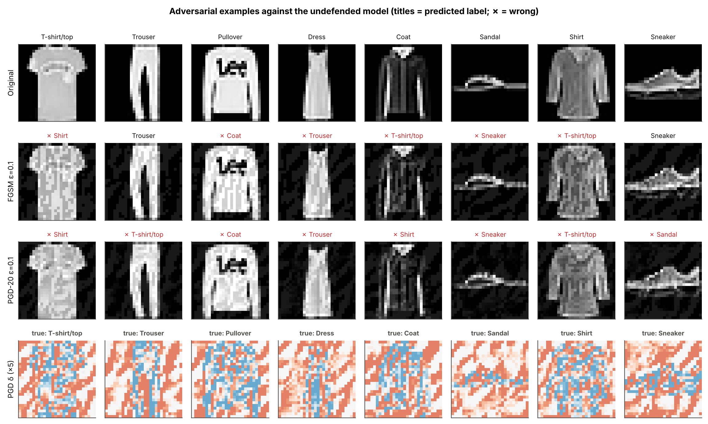
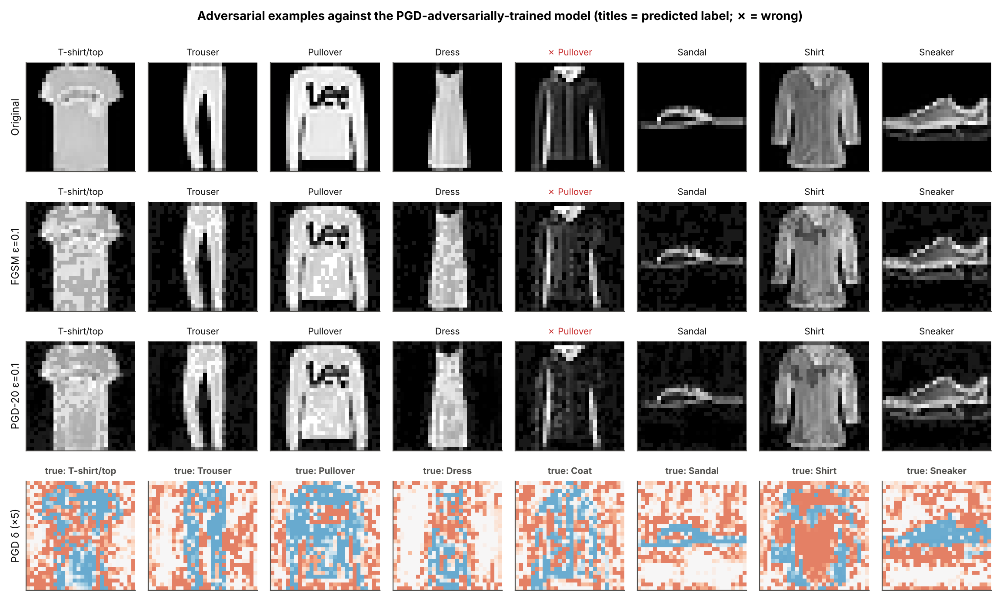
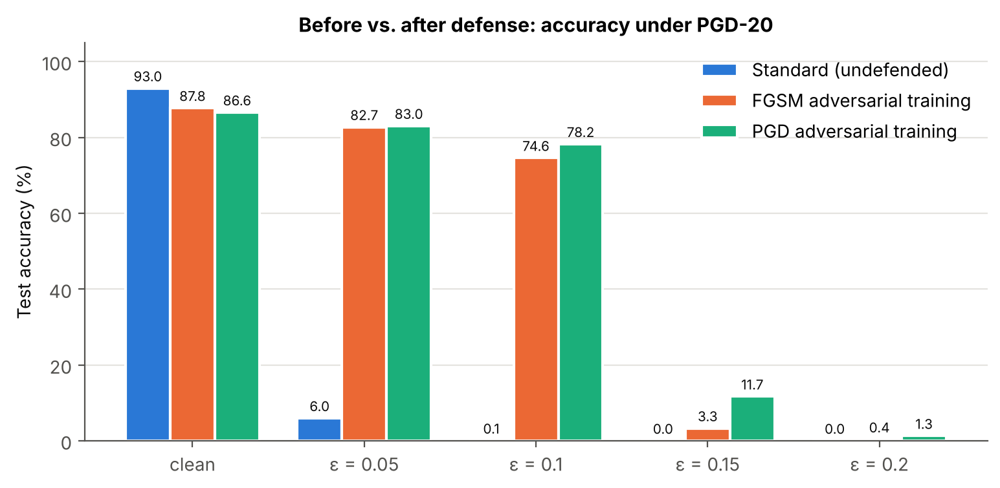
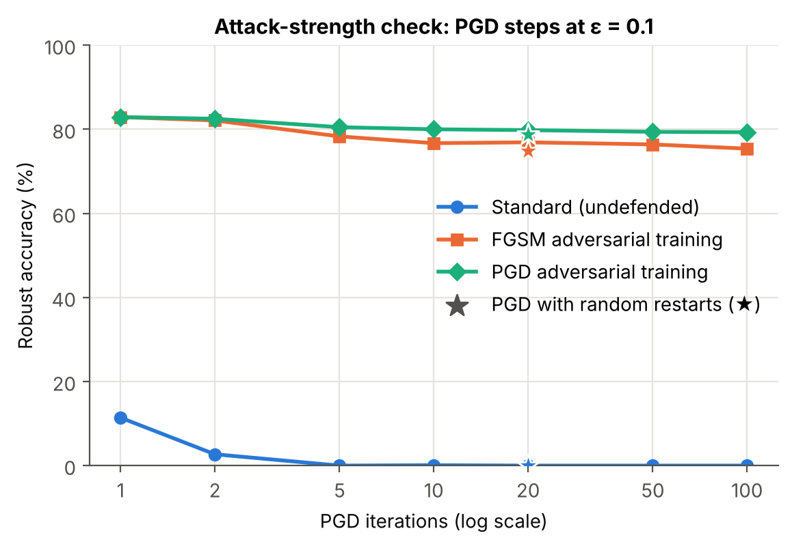
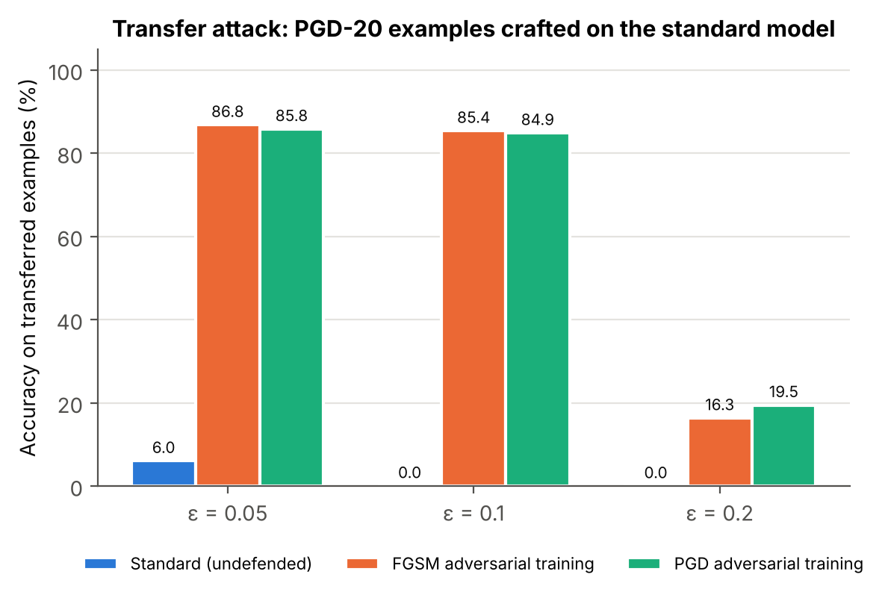

# Adversarial Attacks and Defenses on a Small Fashion-MNIST Classifier: An Empirical Study of FGSM, PGD and Adversarial Training

*Reproducible mini-project. Code, data pipeline and all raw results are in the
`fashion-mnist/` folder of this repository; every number below is read from `results/*.csv` produced by
`run_pipeline.py`.*

---

## Abstract

Adversarial examples are inputs altered by a small, deliberately chosen
perturbation that causes a neural network to misclassify them. They are a
practical security threat for deployed machine-learning systems. We study the
full attack–defense loop on a deliberately small, fully reproducible problem:
a 468k-parameter CNN trained on Fashion-MNIST. The undefended model reaches
92.96% clean test accuracy. Under white-box L∞ attacks it collapses: 20-step
Projected Gradient Descent (PGD) at ε = 0.05 (≈ 13/255) leaves 5.97% accuracy,
and at ε = 0.1 only 0.05%. The single-step Fast Gradient Sign Method (FGSM)
leaves 17.69% at ε = 0.1. We then apply adversarial training at ε = 0.1.
PGD adversarial training raises PGD-20 accuracy at ε = 0.1 from 0.05% to
78.25%, at the cost of 6.36 points of clean accuracy (86.60%). "Fast" FGSM
adversarial training with a random start costs 3.8× less compute per epoch.
It reaches 74.59% PGD-20 accuracy at ε = 0.1 and 87.77% clean accuracy, but
degrades faster under stronger attacks and beyond the training budget. Several
checks suggest the robustness is genuine and not caused by gradient masking.
Robust accuracy of the PGD-trained model plateaus between 20 and 100 PGD
iterations (79.8% → 79.3% on a 1,000-image subset) and changes little with 5
random restarts (78.7%). Black-box transfer attacks from the undefended model
are weaker than white-box ones (84.86% vs. 78.25%), and accuracy goes to ≈0%
at large ε. Robustness is, however, sharply confined to the training budget:
at ε = 0.15, PGD accuracy of the PGD-trained model drops to 11.68%. We discuss
the resulting robustness–accuracy–compute trade-off and the limits of an
empirical, single-seed evaluation.

---

## 1. Introduction

Deep neural networks reach high accuracy on image classification benchmarks.
Yet they can be made to fail by perturbations that are small, carefully
chosen and nearly invisible to humans: these are *adversarial examples*
[1, 2]. For any system in which an adversary controls part of the input, this
is a security problem as well as a curiosity. Examples include content
moderation, malware and spam filters, biometric verification and perception
in autonomous systems. The adversary does not need to tamper with the model
or its training data. It is enough to submit a crafted input at inference
time, a so-called *evasion attack* [3].

This project studies the full attack–defense loop on a deliberately small
problem, so that every experiment runs on a CPU in a single session and can
be reproduced end to end:

1. We train a small convolutional network on Fashion-MNIST [4] and measure its
   clean accuracy.
2. We attack it with the Fast Gradient Sign Method (FGSM) [2] and Projected
   Gradient Descent (PGD) [5] under an L∞ budget ε ranging from 0.01 to 0.3.
3. We defend it with adversarial training, in two variants: multi-step PGD
   adversarial training [5] and single-step "fast" FGSM adversarial training
   with random initialisation [6]. We then re-evaluate on clean and
   adversarial inputs.
4. We test whether the measured robustness is genuine rather than a result of
   *gradient masking* [7]. To do so we sweep the number of attack iterations,
   use random restarts and run a black-box transfer attack.

**Contributions.** (i) A compact, commented and tested PyTorch implementation
of FGSM, PGD and both adversarial-training defenses, together with a single
reproducible pipeline. (ii) A quantitative comparison of an undefended model
and two defended models across eight attack budgets on the full 10,000-image
test set. (iii) A sanity-check suite against gradient masking. (iv) A
discussion of the robustness–accuracy trade-off, the computational cost of
the defenses and the limits of what this evaluation can claim.

## 2. Background and Related Work

### 2.1 Adversarial examples

Let f_θ : [0,1]^d → R^K be a classifier with parameters θ, and let L be the
cross-entropy loss. Given a correctly classified input x with label y, an
*adversarial example* is a point x′ = x + δ with ‖δ‖ ≤ ε such that
argmax f_θ(x′) ≠ y. Szegedy et al. [1] first reported such examples, which
they found with box-constrained L-BFGS. They also showed that the examples
often *transfer* between models trained separately. Biggio et al. [3]
independently framed the problem as a test-time evasion attack on learned
classifiers. Goodfellow et al. [2] argued that the main cause is the
excessive *linearity* of modern networks in high dimensions. In their
argument, a tiny change to each of many input dimensions adds up to a large
change in the logit. Ilyas et al. [8] later argued that adversarial
vulnerability comes from *non-robust features*: patterns that are genuinely
predictive but imperceptible to humans.

**Threat models.** Attacks are characterised by the attacker's goal
(untargeted or targeted), knowledge (white-box or black-box), and capability.
Capability is usually an L_p ball around the clean input. The L∞ ball, which
bounds the change of every pixel by ε, is the most common setting [2, 5] and
the one we adopt.

### 2.2 FGSM and PGD

The **Fast Gradient Sign Method** [2] linearises the loss around x and takes
the maximising step in the L∞ ball:

  x′ = clip_[0,1]( x + ε · sign(∇_x L(f_θ(x), y)) ).

It costs one forward and one backward pass. Kurakin et al. [9] iterated FGSM
with a small step size and clipping, giving the Basic Iterative Method.
Madry et al. [5] added a uniform random start and called the result
**Projected Gradient Descent**:

  x^{t+1} = Π_{B_ε(x) ∩ [0,1]^d}( x^t + α · sign(∇_x L(f_θ(x^t), y)) ),
  x^0 ~ U(B_ε(x)).

Madry et al. argue that PGD is a "universal" first-order adversary. Its local
maxima have very similar loss values, so robustness to PGD is a reasonable
proxy for robustness to any first-order attack. Stronger and more
specialised attacks exist: optimisation-based attacks [10] and parameter-free
ensembles such as AutoAttack [11]. Carlini et al. [12] give guidelines for
evaluating defenses.

### 2.3 Defenses and adversarial training

Many early defenses were later broken. Examples include defensive
distillation [13], broken by [10], and several input-transformation and
stochastic defenses, broken by [7]. Athalye et al. [7] showed that most of
these relied on *obfuscated gradients*: the defense makes gradient-based
attacks fail without making the model robust. Typical symptoms of this
gradient masking are single-step attacks outperforming iterative ones,
black-box attacks outperforming white-box ones, and accuracy that does not
reach zero as ε grows.

**Adversarial training** trains the network on adversarial examples. Szegedy
et al. [1] and Goodfellow et al. [2] proposed it, and Madry et al. [5]
formalised it as a saddle-point problem:

  min_θ E_{(x,y)~D} [ max_{‖δ‖∞ ≤ ε} L(f_θ(x + δ), y) ],

where the inner maximisation is approximated with PGD. It remains one of the
few empirical defenses that has withstood adaptive evaluation [7, 11]. Its
drawbacks are well documented. It costs K+1 times more than standard training
for K-step PGD. It lowers clean accuracy, and Tsipras et al. [14] argue this
trade-off can be inherent. Robust generalisation needs more data [15], and
robust test accuracy can degrade with long training ("robust overfitting")
[16]. TRADES [17] makes the trade-off explicit through a regularisation term.

Single-step adversarial training is cheaper, but naive FGSM training is prone
to *label leaking* [22] and to *catastrophic overfitting* [6]. In catastrophic
overfitting, the model suddenly becomes robust to FGSM but not to PGD, which
is a form of gradient masking. Tramèr et al. [18] showed that FGSM-trained
models learn to mask gradients locally. Wong, Rice and Kolter [6] found that
FGSM training *with a random start* and step size α = 1.25ε recovers most of
PGD training's robustness at a fraction of the cost ("fast is better than
free"). Shafahi et al. [19] proposed a related "free" adversarial training
scheme that reuses gradients. Certified defenses such as convex relaxations
[20] and randomized smoothing [21] give provable guarantees, but at a higher
cost or with a weaker guarantee for L∞. They are outside our scope.

## 3. Methodology

### 3.1 Data

Fashion-MNIST [4] contains 70,000 grayscale 28×28 images of ten clothing
categories (60,000 train / 10,000 test). It is a drop-in replacement for MNIST
but substantially harder: several classes (T-shirt, shirt, pullover, coat)
differ only in subtle texture and shape. This makes the clean-accuracy cost of
robustness visible. Pixels are scaled to [0, 1] and no data augmentation is
used. All models use the official training split; all accuracies are measured
on the official test split.

### 3.2 Model

We use a small VGG-style CNN with 467,818 parameters:
two blocks of [Conv3×3 → ReLU → Conv3×3 → ReLU → MaxPool2] with 32 and 64
channels, then FC(3136→128) → ReLU → FC(128→10). Input normalisation
(mean 0.286, std 0.353) is the first layer of the network. As a result:
(a) the threat model is defined directly in [0, 1] pixel space; (b) clipping
to the valid image range is exact; (c) the attacker needs no knowledge of the
preprocessing. The model has no batch normalisation or dropout, so it computes
the same function in training and evaluation mode. The adversarial examples
generated during adversarial training are therefore adversarial for exactly
the function being optimised.

### 3.3 Threat model

We consider a **white-box, untargeted, test-time evasion** attacker. The
attacker knows the architecture and weights and can compute input gradients.
It may replace a test image x by any x′ with ‖x′ − x‖∞ ≤ ε and x′ ∈ [0,1]^784,
and it succeeds if the predicted label changes. We report **robust accuracy**:
the fraction of test images still classified correctly after the attack. The
defense is designed for ε = 0.1 (≈ 25/255). We evaluate
ε ∈ {0, 0.01, 0.02, 0.05, 0.075, 0.1, 0.15, 0.2, 0.3} to map the full curve,
including budgets beyond the defense's design point. For Fashion-MNIST,
ε = 0.3 is a large perturbation that visibly alters textures. We include it
to confirm that every model is eventually broken, which a properly working
attack must achieve.

### 3.4 Attacks

* **FGSM:** one signed-gradient step of size ε (Section 2.2).
* **PGD-20:** K = 20 iterations, step size α = 2.5ε/K, uniform random start in
  the ε-ball, projection onto the ε-ball and onto [0,1] after every step. The
  evaluation attack uses about three times as many iterations as the 7-step
  attack used for training.

The model is in evaluation mode during every attack, and gradients are taken
with respect to the input only. Unit tests check that the attacks respect the
budget and the valid pixel range, that ε = 0 is the identity, that the attacks
increase the loss, and that seeded runs are deterministic.

### 3.5 Defenses

All three models share the same architecture, initialisation (seed 0), data
order, optimiser and schedule: Adam, learning rate 10⁻³ with cosine decay to 0,
batch size 128, 10 epochs. **Only the training objective differs:**

* **Standard:** empirical risk minimisation on clean images.
* **FGSM-AT (fast adversarial training) [6]:** each batch is replaced by
  x′ = Π(x + η + 1.25ε·sign(∇_x L(x + η))), with η ~ U[−ε, ε]^d and ε = 0.1.
  Cost: two forward/backward passes per step.
* **PGD-AT [5]:** each batch is replaced by a PGD-7 adversarial batch
  (α = ε/4 = 0.025, random start, ε = 0.1). Cost: eight forward/backward passes
  per step.

As in Madry et al. [5], we train on 100% adversarial batches, with no clean
examples mixed in. We use no early stopping or model selection: the model
after the last epoch is evaluated.

### 3.6 Evaluation protocol

1. **ε sweep:** clean, FGSM and PGD-20 accuracy for all three models at all
   nine ε values on the full 10,000-image test set (Table 1, Fig. 1, Fig. 3).
2. **Attack-strength / gradient-masking checks** at ε = 0.1 on the first
   1,000 test images: PGD with K ∈ {1, 2, 5, 10, 20, 50, 100} iterations, and
   PGD-20 with 5 random restarts. For restarts, an image counts as robust only
   if it survives all five (Fig. 4).
3. **Black-box transfer:** PGD-20 examples are crafted on the undefended model
   at ε ∈ {0.05, 0.1, 0.2} and fed to all three models (Fig. 5).
4. **Qualitative examples:** one test image per class for eight classes,
   attacked at ε = 0.1 (Fig. 2).

With n = 10,000 test images, the half-width of a 95% binomial confidence
interval on an accuracy p is 1.96·√(p(1−p)/n) ≤ 0.98 percentage points. With
n = 1,000 it is ≤ 3.1 points. All runs used a 4-core CPU with no GPU.
Wall-clock timings are recorded in `results/run_info.json`.

## 4. Experiments and Results

The full pipeline (`python run_pipeline.py`) ran in 100.2 minutes on a 4-core
CPU (PyTorch 2.15, Python 3.13, no GPU). Every number in this section is taken
verbatim from `results/metrics_table.csv`, `results/pgd_convergence.csv`,
`results/transfer_attack.csv`, `results/training_log.csv` and
`results/run_info.json`.

### 4.1 Baseline: clean accuracy and training cost

| Model | Clean test acc. | Final training loss* | Mean time / epoch | Relative cost | Total training time** |
|---|---:|---:|---:|---:|---:|
| Standard | **92.96%** | 0.060 | 23.4 s | 1.0× | 4.3 min |
| FGSM-AT (ε = 0.1) | 87.77% | 0.386 | 43.7 s | 1.9× | 7.7 min |
| PGD-AT (ε = 0.1, 7 steps) | 86.60% | 0.469 | 167.4 s | 7.2× | 28.3 min |

*Cross-entropy on the batches the model was trained on: clean batches
for Standard, adversarial batches for the AT models. **Includes the per-epoch
clean test evaluation.

The undefended CNN reaches 92.96% clean accuracy after 10 epochs, a typical
value for a small CNN on Fashion-MNIST without augmentation. Both adversarial
training methods converge smoothly (Fig. 6). They cost clean accuracy:
5.19 points for FGSM-AT and 6.36 points for PGD-AT. Their training loss stays
far higher than the standard model's (0.39–0.47 vs. 0.06), because fitting
the worst case in an ε-ball is a much harder task. PGD-AT costs 7.2× a
standard epoch, close to the theoretical 8× (7 attack steps + 1 update);
FGSM-AT costs 1.9× (theoretical 2×).

*Figure 6. Training loss (left) and clean test accuracy (right) per epoch. No
model selection was performed; the epoch-10 model is evaluated.*

### 4.2 Attacking the undefended model

**Table 1.** Test accuracy (%) on the full 10,000-image test set, for each model
and attack at each L∞ budget ε. ε = 0 is clean accuracy.

| Model | Attack | ε=0 | 0.01 | 0.02 | 0.05 | 0.075 | **0.1** | 0.15 | 0.2 | 0.3 |
|---|---|---:|---:|---:|---:|---:|---:|---:|---:|---:|
| Standard | FGSM | 92.96 | 74.14 | 55.95 | 31.79 | 23.61 | **17.69** | 11.68 | 9.45 | 7.63 |
| Standard | PGD-20 | 92.96 | 70.16 | 44.73 | 5.97 | 0.34 | **0.05** | 0.00 | 0.00 | 0.00 |
| FGSM-AT | FGSM | 87.77 | 87.05 | 86.15 | 84.00 | 82.53 | **81.45** | 57.46 | 18.83 | 10.61 |
| FGSM-AT | PGD-20 | 87.77 | 87.01 | 85.98 | 82.74 | 79.76 | **74.59** | 3.31 | 0.36 | 0.02 |
| PGD-AT | FGSM | 86.60 | 85.95 | 85.29 | 83.65 | 82.35 | **80.92** | 51.80 | 21.45 | 11.10 |
| PGD-AT | PGD-20 | 86.60 | 85.94 | 85.21 | 83.05 | 81.05 | **78.25** | 11.68 | 1.29 | 0.11 |

The standard model is extremely fragile (Table 1, Fig. 1). A perturbation of
only ε = 0.01 (≈ 2.5/255 per pixel) lowers accuracy from 92.96% to 74.14% under FGSM and to 70.16% under PGD.
At ε = 0.02, PGD already lowers accuracy below 50% (44.73%). At ε = 0.05, PGD
leaves 5.97%, and at ε = 0.1 just 5 of 10,000 test images (0.05%) are still
classified correctly. PGD is consistently stronger than FGSM. The gap is
largest at medium budgets: at ε = 0.1, FGSM leaves 17.69% accuracy where PGD
leaves 0.05%. FGSM never pushes the undefended model to zero. At ε = 0.3 it
still leaves 7.63% accuracy, because a single linearised step of a large size
"overshoots" a loss surface that is not linear at that scale [9, 2].

*Figure 1. Test accuracy vs. L∞ budget ε under FGSM (left) and PGD-20 (right)
for the three models. The dashed line marks the training budget of the
defenses (ε = 0.1); the dotted line marks chance level.*

Figure 2 (top) shows eight test images, one per class, attacked at ε = 0.1.
All eight are correctly classified when clean. FGSM flips six of them, and
PGD-20 flips all eight, mostly to semantically adjacent classes (T-shirt →
Shirt, Pullover → Coat, Shirt → T-shirt, Sneaker → Sandal), but also to
implausible ones such as Dress → Trouser. To a human the perturbed images are
still obviously the original garment, with a faint diagonal texture. The
amplified perturbation (bottom row; red = pixel brightened, blue = darkened)
of the undefended model is a high-frequency pattern of diagonal stripes that
covers the background as much as the object. This is consistent with the
view that standard models rely on non-robust, imperceptible features [8].

*Figure 2. One test image per class (first eight classes), attacked at
ε = 0.1. Titles show the model's prediction; "✗" and red text mark a wrong
prediction. Bottom row: PGD perturbation δ amplified 5×. Top: undefended model
(PGD fools 8/8). Bottom: PGD-adversarially-trained model, with attacks
recomputed against this model. Its predictions are unchanged by either attack
(7/8 correct; the coat is already misclassified as a pullover on the clean
image).*

### 4.3 Effect of the defenses

**Robustness at the design budget.** At ε = 0.1, adversarial training turns a
model that is almost completely broken (0.05% PGD accuracy) into one that
classifies most adversarial inputs correctly: 74.59% (FGSM-AT) and 78.25%
(PGD-AT) under PGD-20 (Table 1, Fig. 3). The gain is large at every budget up to
the design point. At ε = 0.05, PGD accuracy rises from 5.97% to 82.74% / 83.05%.
At ε = 0.075 it rises from 0.34% to 79.76% / 81.05%. Up to ε = 0.1, PGD-AT's
robust accuracy stays within 8.35 points of its own clean accuracy; FGSM-AT's
gap reaches 13.18 points.

**PGD-AT vs. FGSM-AT.** PGD-AT is more robust against the stronger attack, and
the difference grows with ε: +0.31 points at ε = 0.05, +1.29 at ε = 0.075,
+3.66 at ε = 0.1 and +8.37 at ε = 0.15. The differences at ε ≥ 0.075 exceed
the ≈ ±0.8-point 95% sampling half-width at these accuracies. Both models are
evaluated on the same test images, so the paired comparison is tighter still. Against FGSM, the two defenses are indistinguishable at ε ≤ 0.1
(81.45% vs. 80.92% at ε = 0.1). The single-step-trained model looks slightly
*better* when judged only by the attack it was trained against. This
illustrates why defenses must be evaluated with attacks stronger than the one
used in training [12]. In exchange, FGSM-AT retains 1.17 more points of clean
accuracy and trains 3.8× faster per epoch (43.7 s vs. 167.4 s).

*Figure 3. Accuracy under PGD-20 before (standard) and after (FGSM-AT, PGD-AT)
defense at selected budgets.*

**Beyond the design budget.** Robustness is sharply confined to the ball the
model was trained on. Going from ε = 0.1 to ε = 0.15, PGD accuracy falls from
78.25% to 11.68% for PGD-AT and from 74.59% to 3.31% for FGSM-AT. At ε = 0.2
both are below 1.3%, and at ε = 0.3 both are at ≈0%. FGSM accuracy decays much
more slowly (51.80% / 57.46% at ε = 0.15). Outside the trained region, the
single-step linear approximation becomes a poor attack.

### 4.4 Is the robustness real? Gradient-masking checks

A defense that *obfuscates* gradients can look robust against gradient-based
attacks without being robust [7]. We test the defended models for the
standard symptoms.

**(a) More iterations and restarts (Fig. 4).** On the first 1,000 test images
at ε = 0.1, PGD-AT's robust accuracy goes 82.9% (1 step) → 80.5% (5) → 79.8%
(20) → 79.4% (50) → 79.3% (100). It loses only 0.5 points between 20 and 100
iterations. Five random restarts of PGD-20 give 78.7%, i.e. 1.1 points below a
single PGD-20 run. The attack has essentially converged. For FGSM-AT the
corresponding numbers are 82.9% → 78.3% → 76.9% → 76.4% → 75.4%, and 74.9%
with restarts. Its accuracy keeps drifting down slightly longer: 1.5 points
from 20 to 100 steps, and 2.0 points with restarts. This suggests a somewhat
less smooth loss surface around its inputs, consistent with reports that
single-step training induces some local gradient masking [18]. It is far from
catastrophic overfitting [6], though, which would show up as PGD accuracy
collapsing towards 0 while FGSM accuracy stays high. The undefended model
is at ≤ 0.1% from 5 PGD steps onward.

*Figure 4. Robust accuracy at ε = 0.1 vs. number of PGD iterations (first
1,000 test images; ★ = PGD-20 with 5 random restarts, worst case per image).*

**(b) Black-box transfer is weaker than white-box (Fig. 5).** PGD-20 examples
crafted on the undefended model at ε = 0.1 are almost always misclassified by
that model (0.03% accuracy). They transfer poorly to the defended models,
which keep 85.38% (FGSM-AT) and 84.86% (PGD-AT) accuracy, much higher than
under their own white-box attacks (74.59% and 78.25%). At ε = 0.05 transfer
accuracy is 86.80% / 85.81%, near clean accuracy. If the defense were merely
hiding its gradients, a transfer attack that does not use them would be
expected to do *better* than the white-box attack [7]; we observe the opposite.
At ε = 0.2, transferred examples do hurt the defended models (16.34% /
19.46%), but white-box PGD is still stronger (0.36% / 1.29%).

*Figure 5. Accuracy of each model on PGD-20 adversarial examples crafted on
the undefended model (black-box transfer setting).*

**(c) Other sanity checks.** Across all 24 (model, ε > 0) cells of Table 1,
PGD is at least as strong as FGSM. Every model, defended or not, is driven to
≈0% PGD accuracy at ε = 0.3 (0.00%, 0.02%, 0.11%), so the attack is not being
blocked by saturated or shattered gradients. Unit tests confirm that every
adversarial example lies inside the ε-ball and in [0, 1], and the evaluation
code re-asserts this for every batch.

Taken together, (a)–(c) pass the standard checklist for ruling out gradient
masking [7, 12]. The PGD-AT model in particular shows the behaviour expected
of genuinely robust training. This is evidence, not proof: Section 5
discusses what stronger evaluations could add.

**Qualitative change in the perturbations.** Figure 2 (bottom) shows that the
PGD perturbations against the robust model are no longer texture-like noise
spread over the whole image. They concentrate on the object and its outline:
they trace the soles of the sandal and sneaker and the collar and body of the
shirt. The attacker can only succeed by changing class-relevant shape
features, which a 0.1 budget is mostly not enough to do. This matches the
"perceptually aligned gradients" reported for adversarially trained models
[14].

## 5. Discussion and Limitations

**Security interpretation.** In the white-box L∞ threat model, the undefended
classifier offers essentially no security. An attacker with gradient access
can push accuracy below 50% with ε = 0.02, a per-pixel change of about 5/255
that is invisible in practice. Even the one-shot FGSM attack, which costs a
single gradient evaluation, cuts accuracy at ε = 0.05 by a factor of three.
Adversarial training is an effective, conceptually simple mitigation *for the
threat model it is trained on*. With PGD-AT, an attacker restricted to
ε = 0.1 succeeds on about 22% of test images rather than ~100%. Some of those
failures (13.4% of the test set) were already misclassified on clean inputs.

**Three trade-offs.** (1) *Robustness vs. clean accuracy:* both defenses
cost 5–6 points of clean accuracy, in line with the trade-off described by
Tsipras et al. [14]. For a system that rarely faces an attacker, this cost applies to
every benign input. (2) *Robustness vs. compute:* PGD-AT costs 7.2× standard
training; FGSM-AT costs 1.9× and keeps 95% of PGD-AT's robust accuracy at
ε = 0.1 (74.59 / 78.25). Its weaknesses show up only under stronger,
multi-step attacks and slightly above the design budget. (3) *Robustness vs.
threat-model coverage:* the defense protects the ε-ball it was trained on and
little beyond it. PGD-AT goes from 78.25% at ε = 0.1 to 11.68% at ε = 0.15. A
deployed defense therefore depends on correctly guessing the attacker's
budget. An attacker who can afford a larger or differently shaped perturbation
(L2, patches, spatial transformations) is not addressed at all.

**Limitations.**

* *Single seed and short training.* Each model was trained once (seed 0) for
  10 epochs. Sampling uncertainty on 10,000 test images is ≤ ±1 point (95%),
  but seed-to-seed variation was not measured. Longer training may improve
  clean and robust accuracy, or cause robust overfitting [16]. The small
  differences between FGSM-AT and PGD-AT at ε ≤ 0.075 (≤ 1.3 points) should
  not be over-interpreted.
* *Attack strength.* PGD-20 with random start is a strong first-order attack,
  and our convergence checks indicate it has nearly converged. It is not the
  strongest available evaluation. AutoAttack [11] (APGD with adaptive step
  size and the DLR loss, plus FAB and Square) typically lowers reported robust
  accuracy by a few more points. Optimisation-based [10] and query-based
  black-box attacks were not run. Our robust accuracies are therefore
  **upper bounds** on true robustness within the threat model.
* *Empirical, not certified.* No guarantee is given for any input. Certified
  methods [20, 21] would provide one, at a cost in accuracy and compute.
* *Scale.* Fashion-MNIST is small and low-resolution, and the CNN has under
  0.5M parameters. The qualitative findings (fragility of standard models,
  effectiveness and cost of adversarial training, sharp ε-boundary) are well
  established on larger datasets. The specific numbers do not transfer to,
  e.g., CIFAR-10 or ImageNet, where robust accuracies are much lower.
* *Threat-model scope.* Only untargeted L∞ evasion is studied. Targeted
  attacks, other norms, physical-world perturbations, data poisoning and model
  extraction are out of scope.
* *Monitoring on the test set.* Clean test accuracy was logged after every
  epoch to draw Fig. 6, but no decision (epochs, hyper-parameters, checkpoint)
  was based on it. All hyper-parameters were fixed in advance from the
  literature [5, 6].

**Future work.** Natural extensions are: multiple seeds with confidence
intervals; AutoAttack evaluation; TRADES [17] to tune the robustness/accuracy
trade-off; curriculum or multi-ε training to soften the drop beyond the
training budget; and repeating the study on CIFAR-10.

## 6. Conclusion

We built a compact, reproducible pipeline for studying adversarial robustness
and used it to measure the full attack–defense loop on Fashion-MNIST. A
standard CNN with 92.96% clean accuracy is reduced to 0.05% accuracy by a
20-step PGD attack at ε = 0.1, and to 17.69% by single-step FGSM. PGD
adversarial training restores 78.25% accuracy under the same PGD attack, for a
6.36-point clean-accuracy cost and 7.2× the training compute. Fast FGSM
adversarial training recovers most of that robustness (74.59%) at 1.9× the
compute, but is measurably weaker under stronger attacks and beyond the
training budget. Convergence, restart and transfer checks indicate that the
measured robustness is not an artefact of gradient masking. The robustness
holds, however, only within the trained ε-ball: at ε = 0.15 even the
PGD-trained model falls to 11.68%. Adversarial training is a real but narrow
defense. It works for the threat model it is designed for, and it must be
evaluated with attacks stronger than the one it was trained against.

## References

[1] C. Szegedy, W. Zaremba, I. Sutskever, J. Bruna, D. Erhan, I. Goodfellow, R. Fergus. *Intriguing properties of neural networks.* ICLR, 2014.

[2] I. J. Goodfellow, J. Shlens, C. Szegedy. *Explaining and harnessing adversarial examples.* ICLR, 2015.

[3] B. Biggio, I. Corona, D. Maiorca, B. Nelson, N. Šrndić, P. Laskov, G. Giacinto, F. Roli. *Evasion attacks against machine learning at test time.* ECML PKDD, 2013.

[4] H. Xiao, K. Rasul, R. Vollgraf. *Fashion-MNIST: a novel image dataset for benchmarking machine learning algorithms.* arXiv:1708.07747, 2017.

[5] A. Madry, A. Makelov, L. Schmidt, D. Tsipras, A. Vladu. *Towards deep learning models resistant to adversarial attacks.* ICLR, 2018.

[6] E. Wong, L. Rice, J. Z. Kolter. *Fast is better than free: Revisiting adversarial training.* ICLR, 2020.

[7] A. Athalye, N. Carlini, D. Wagner. *Obfuscated gradients give a false sense of security: Circumventing defenses to adversarial examples.* ICML, 2018.

[8] A. Ilyas, S. Santurkar, D. Tsipras, L. Engstrom, B. Tran, A. Madry. *Adversarial examples are not bugs, they are features.* NeurIPS, 2019.

[9] A. Kurakin, I. Goodfellow, S. Bengio. *Adversarial examples in the physical world.* ICLR Workshop, 2017.

[10] N. Carlini, D. Wagner. *Towards evaluating the robustness of neural networks.* IEEE Symposium on Security and Privacy, 2017.

[11] F. Croce, M. Hein. *Reliable evaluation of adversarial robustness with an ensemble of diverse parameter-free attacks.* ICML, 2020.

[12] N. Carlini, A. Athalye, N. Papernot, W. Brendel, J. Rauber, D. Tsipras, I. Goodfellow, A. Madry, A. Kurakin. *On evaluating adversarial robustness.* arXiv:1902.06705, 2019.

[13] N. Papernot, P. McDaniel, X. Wu, S. Jha, A. Swami. *Distillation as a defense to adversarial perturbations against deep neural networks.* IEEE Symposium on Security and Privacy, 2016.

[14] D. Tsipras, S. Santurkar, L. Engstrom, A. Turner, A. Madry. *Robustness may be at odds with accuracy.* ICLR, 2019.

[15] L. Schmidt, S. Santurkar, D. Tsipras, K. Talwar, A. Madry. *Adversarially robust generalization requires more data.* NeurIPS, 2018.

[16] L. Rice, E. Wong, J. Z. Kolter. *Overfitting in adversarially robust deep learning.* ICML, 2020.

[17] H. Zhang, Y. Yu, J. Jiao, E. P. Xing, L. El Ghaoui, M. I. Jordan. *Theoretically principled trade-off between robustness and accuracy.* ICML, 2019.

[18] F. Tramèr, A. Kurakin, N. Papernot, I. Goodfellow, D. Boneh, P. McDaniel. *Ensemble adversarial training: Attacks and defenses.* ICLR, 2018.

[19] A. Shafahi, M. Najibi, A. Ghiasi, Z. Xu, J. Dickerson, C. Studer, L. S. Davis, G. Taylor, T. Goldstein. *Adversarial training for free!* NeurIPS, 2019.

[20] E. Wong, J. Z. Kolter. *Provable defenses against adversarial examples via the convex outer adversarial polytope.* ICML, 2018.

[21] J. Cohen, E. Rosenfeld, J. Z. Kolter. *Certified adversarial robustness via randomized smoothing.* ICML, 2019.

[22] A. Kurakin, I. Goodfellow, S. Bengio. *Adversarial machine learning at scale.* ICLR, 2017.

[23] D. P. Kingma, J. Ba. *Adam: A method for stochastic optimization.* ICLR, 2015.

[24] A. Paszke et al. *PyTorch: An imperative style, high-performance deep learning library.* NeurIPS, 2019.

