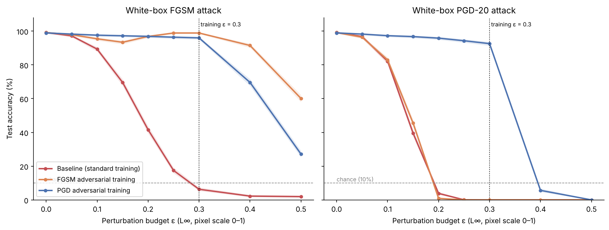
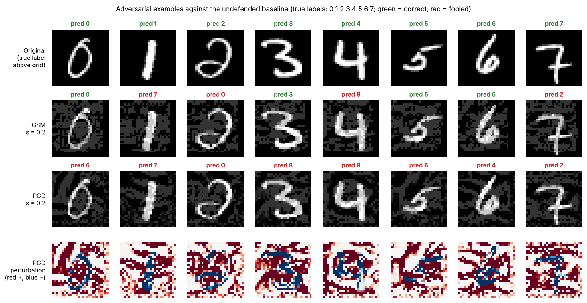
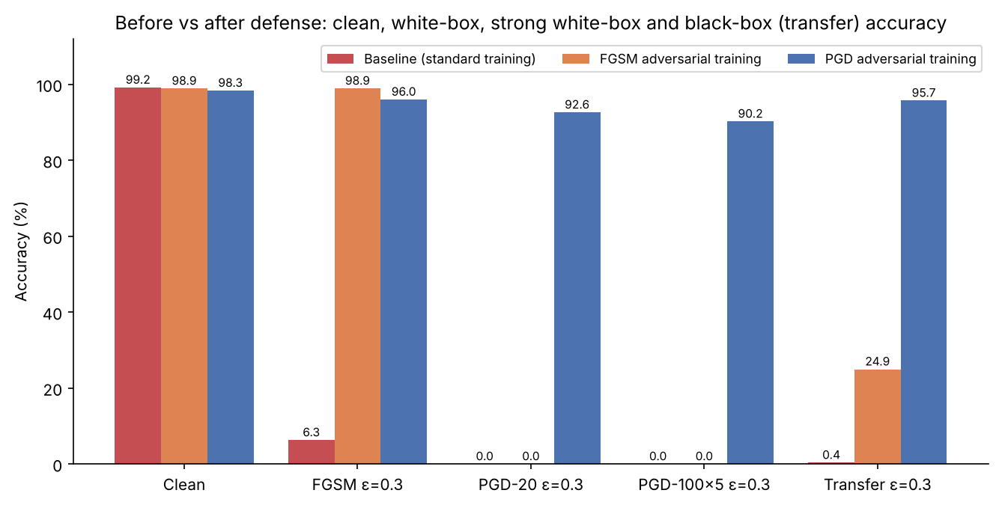
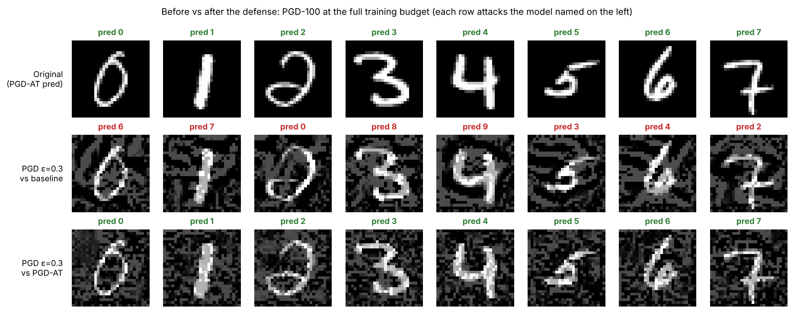
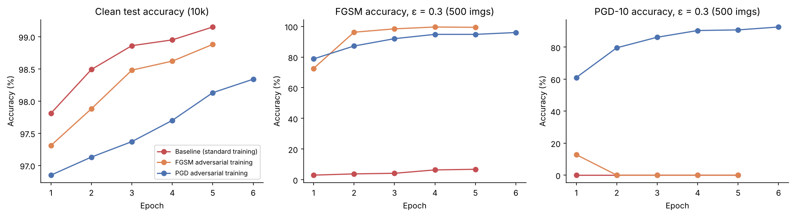

# Fooling and Hardening a Small MNIST Classifier: FGSM and PGD Attacks, and Why Only One of Two Adversarial-Training Defenses Works

*Research mini-project. Every number and figure in this paper is produced by
`python run_pipeline.py` (seed 42) and can be found in
[`results/`](../results/).*

---

## Abstract

Small, carefully chosen input perturbations can make an accurate image
classifier wrong with near certainty. We study this on a deliberately small,
fully reproducible setup: a 225k-parameter CNN trained on MNIST on a CPU.
We implement two white-box L∞ attacks, FGSM and PGD, and two
adversarial-training defenses, FGSM-based and PGD-based. Every robustness
claim is subjected to sanity checks for gradient masking. The undefended
model reaches **99.15%** clean accuracy, but PGD reduces it to **3.9%** at
ε = 0.2 and **0.0%** at ε = 0.3. FGSM adversarial training looks highly
effective: **98.9%** accuracy against FGSM at ε = 0.3. Yet it has **0.0%**
accuracy against PGD at ε = 0.3, and at ε = 0.1 it is no more robust than
the undefended model (83.0% vs 82.2%). Its FGSM accuracy *increases* with ε,
and a black-box transfer attack beats the white-box FGSM attack (24.9%).
Both are signatures of gradient masking; the training log shows the
collapse ("catastrophic overfitting") within one epoch. PGD adversarial
training gives real robustness: **92.6%** under PGD-20 and **90.2%** under a
much stronger PGD-100 with 5 random restarts at ε = 0.3, at a cost of 0.8
points of clean accuracy (98.34%) and about 5× the training compute.
Its robustness holds against black-box transfer (95.7%) and vanishes, as it
should, beyond the training budget (5.7% at ε = 0.4, 0.0% at ε = 0.5). The
main lesson is about evaluation: a defense judged only by the attack it was
trained against can appear perfect while providing no security at all.

---

## 1. Introduction

Deep neural networks reach human-level accuracy on many perception tasks.
Yet they can be made to misclassify inputs carrying perturbations so small
that a human does not notice them or ignores them [1, 2]. These
*adversarial examples* are a security problem whenever a model's decision
matters to someone motivated to change it: content filters, malware and
spam detectors, biometric authentication, document and cheque processing,
and the perception stack of autonomous systems. They are also a
reliability problem, because they show that high test accuracy does not
mean a model has learned the features humans would consider relevant [3].

This project studies the full attack-defense loop on a deliberately small,
fully reproducible setup: a 225k-parameter convolutional network trained on
MNIST on a CPU. We ask three questions:

1. **RQ1 – Vulnerability:** how quickly does a standard, accurate classifier
   fail under white-box L∞ attacks of increasing strength, and how do a
   single-step attack (FGSM) and an iterative attack (PGD) compare?
2. **RQ2 – Defense:** how much robustness do two adversarial-training
   defenses buy, cheap FGSM adversarial training and PGD adversarial
   training, and at what cost in clean accuracy and compute?
3. **RQ3 – Evaluation validity:** is the measured robustness real, or an
   artefact of a weak or masked attack? We apply the sanity checks
   recommended in the literature [6, 7]: iterative vs single-step attacks,
   an unbounded-ε test, a much stronger attack with random restarts, and
   black-box transfer attacks.

**Contributions.** (1) A modular PyTorch implementation of FGSM, PGD (with
random starts and restarts), and FGSM- and PGD-based adversarial training,
with unit tests. (2) A one-command pipeline with byte-for-byte
reproducible outputs. (3) An evaluation of four models with confidence
intervals and robustness sanity checks. (4) A worked example of how a weak
attack overstates robustness: the FGSM-trained model looks robust to FGSM
but is not robust to PGD.

---

## 2. Background and Related Work

### 2.1 Adversarial examples

Szegedy et al. [1] showed that imperceptible, optimised perturbations
reliably change the predictions of state-of-the-art image classifiers, and
that such perturbations often *transfer* between models trained separately.
Biggio et al. [4] had earlier demonstrated gradient-based evasion attacks
against SVMs and neural networks in a security setting (malware and spam
detection). Goodfellow et al. [2] argued that the cause is not
overfitting or non-linearity but the *excessive linearity* of models in
high dimensions. For a linear score wᵀx, the change wᵀδ caused by an L∞
perturbation of size ε can reach ε‖w‖₁, which grows with the input
dimension even though every coordinate changes by at most ε. Later work
connected adversarial vulnerability to the use of *non-robust features*:
features that predict the label well on natural data but are brittle and
imperceptible to humans [3].

**Threat models.** An attack is defined by the attacker's goal (untargeted
misclassification or a chosen target class), knowledge (white-box access
to weights and gradients, or black-box query/transfer access), and
capability, usually an Lp-norm bound ‖δ‖p ≤ ε on the perturbation [6].
For MNIST the L∞ bound ε = 0.3 (pixel range [0, 1]) is the conventional
benchmark [5].

### 2.2 FGSM and PGD

The **Fast Gradient Sign Method (FGSM)** [2] linearises the loss L around
the input and takes the optimal L∞-bounded step for the linear model:

  x_adv = clip₍₀,₁₎( x + ε · sign(∇ₓ L(f(x), y)) ).

It costs one forward and one backward pass. Its basic iterative variant,
BIM [8], repeats small steps with clipping.
**Projected Gradient Descent (PGD)** [5] adds a random start inside the
ε-ball and projects after every step:

  x₀ = x + U(−ε, ε),  x_{t+1} = Proj_{B∞(x, ε) ∩ [0,1]}( x_t + α · sign(∇ₓ L(f(x_t), y)) ).

Madry et al. [5] argue that PGD is a "universal first-order adversary":
the local maxima it finds have similar loss values, so robustness to PGD is
a good proxy for robustness to any attack that uses first-order
information. Stronger or more efficient attacks exist, e.g.
Carlini-Wagner [9] for L2 and AutoAttack [10] as a parameter-free ensemble.
PGD with enough steps and restarts nevertheless remains the standard
baseline.

### 2.3 Adversarial training and gradient masking

**Adversarial training** augments training with adversarial examples.
Goodfellow et al. [2] trained on a 50/50 mixture of clean and FGSM
examples. Madry et al. [5] formulated robust training as a saddle-point
problem,

  min_θ E_(x,y) [ max_{‖δ‖∞ ≤ ε} L(f_θ(x + δ), y) ],

and solved the inner maximisation with PGD. This produced MNIST models
that remain about 89% accurate against strong white-box attacks at ε = 0.3.
The cost is a multiple of standard training (one forward/backward pass per
PGD step), which has motivated cheaper variants [12, 20]. Robust models
typically lose some clean accuracy [19], and their input gradients and
adversarial perturbations look more perceptually aligned [19].

Many proposed defenses were later found to provide only a false sense of
security. They **mask or obfuscate gradients**, so gradient-based attacks
fail, without making the model robust [6, 13]. Single-step adversarial
training is a known instance: the model can learn a loss surface that is
highly curved near the data, so the one-step linear approximation used by
FGSM points in a useless direction. FGSM accuracy then rises while
iterative-attack accuracy stays low [11, 14]. Kurakin et al. [11] found that
single-step adversarial training protects against single-step attacks but
not iterative ones. Tramèr et al. [14] traced this to a degenerate minimum
in which the loss surface curves sharply near the data points. Wong et al.
[12] observed a related failure, *catastrophic overfitting*. Carlini et al. [7] give a checklist for
detecting such failures. Iterative attacks must beat single-step ones;
accuracy must reach zero when ε is unbounded; more steps and restarts
must not reveal sharply lower accuracy; and black-box transfer attacks
should not beat white-box attacks. We adopt these checks in Section 3.5.

**Certified defenses** provide provable guarantees inside the ε-ball, e.g.
via convex relaxations [15], interval bound propagation [16] or randomised
smoothing [17]. Their guarantees are usually achieved at smaller ε or lower
accuracy. We restrict ourselves to empirical defenses.

---

## 3. Methodology

### 3.1 Data and model

We use MNIST [18]: 60,000 training and 10,000 test images of handwritten
digits, 28×28 grey-scale, loaded through torchvision. Pixel values are
scaled to [0, 1] and **not normalised**, so the L∞ budget ε is directly
"maximum change per pixel", and the valid-input constraint is the unit box.

The classifier (`src/advrobust/model.py`) is a small CNN with 225,034
parameters: conv 3×3 (32) → ReLU → max-pool → conv 3×3 (64) → ReLU →
max-pool → FC 128 → ReLU → FC 10. It has no batch normalisation or dropout,
so the model is deterministic and identical in training and evaluation mode.

### 3.2 Attacks

Both attacks (`src/advrobust/attacks.py`, implemented in PyTorch [23]) are
untargeted, white-box and L∞ bounded. They maximise the cross-entropy loss and enforce x_adv ∈ [0, 1].

* **FGSM:** a single step of size ε.
* **PGD-k:** uniform random start in the ε-ball, k steps of size
  α = 2.5·ε/k (Madry et al.'s heuristic: the iterate can cross the ball
  and come back), and projection onto the ε-ball ∩ [0, 1] after each step.
  The ε-sweeps use k = 20. The strong check uses k = 100 with 5 random
  restarts, keeping for each example the first restart that succeeds.

### 3.3 Models and training

All models use Adam (learning rate 10⁻³, divided by 10 for the final
epoch) with batch size 128 (`src/advrobust/train.py`).

| Model | Training objective | Epochs | Gradient passes per step (measured time/epoch vs baseline) |
|---|---|---|---|
| **Baseline** | cross-entropy on clean images | 5 | 1 (1×) |
| **Surrogate** | as baseline, different seed (initialisation and batch order) | 5 | 1 (~1×) |
| **FGSM-AT** | 0.5·CE(clean) + 0.5·CE(FGSM_ε(clean)), as in [2] | 5 | 2 (1.9×) |
| **PGD-AT** | CE(PGD-7_ε(clean)) only, as in [5] | 6 | 8 (4.9×; attack steps need no parameter update) |

Both adversarially trained models use ε = 0.3, ramped linearly from 0 over
the first epoch. This warm-up stops a small network from stalling at chance
accuracy at the start of training. It is a common curriculum device and
does not affect the final objective. The surrogate exists only to craft
black-box transfer attacks (Section 3.5).

### 3.4 Evaluation protocol

* **Clean accuracy** on the full 10,000-image test set.
* **ε-sweep:** accuracy under FGSM and PGD-20 at ε ∈ {0, 0.05, 0.1, 0.15,
  0.2, 0.25, 0.3, 0.4, 0.5}. To keep the compute reasonable on a CPU, it
  uses a fixed, seeded random subset of 2,000 test images. Every accuracy
  carries a 95% Wilson score interval (half-width ≤ 2.2 percentage points
  at n = 2,000).
* **Headline setting:** ε = 0.3, the MNIST convention and the training
  budget of both defenses.

### 3.5 Robustness sanity checks

Following [6, 7], we test whether the measured robustness could be an
artefact:

1. **Iterative vs single-step:** PGD accuracy should not exceed FGSM
   accuracy. If FGSM accuracy is much *higher* than PGD accuracy, the
   single-step attack is being defeated by the loss geometry (gradient
   masking).
2. **Unbounded attack:** as ε grows towards 0.5, an attack can move any
   image to an uninformative grey image, so accuracy should approach
   chance or zero.
3. **Strong attack:** PGD-100 with 5 random restarts on the first 1,000
   images of the evaluation subset, compared with PGD-20 on the same
   images at ε = 0.3. A large gap would mean that PGD-20 underestimates
   the attacker.
4. **Black-box transfer:** PGD-20 examples crafted on the independently
   trained surrogate (white-box against the surrogate) are fed to each
   model. Transfer attacks should be *weaker* than white-box attacks; if
   they are stronger, the white-box gradients are probably obfuscated.

### 3.6 Reproducibility

Every source of randomness is seeded: initialisation, batch order, PGD
starts and the evaluation subset. Deterministic PyTorch kernels are
enforced, and running the pipeline twice yields byte-identical result files
(Section 4.6).

---

## 4. Experiments and Results

All runs use seed 42 and 4 CPU threads. The full pipeline took 32 minutes
(`results/timings.json`; wall-clock times are machine-dependent).

### 4.1 Clean accuracy and training cost

| Model | Clean test accuracy (10k) | Training time | Time per epoch |
|---|---|---|---|
| Baseline | **99.15%** | 116 s (5 epochs) | ~23 s |
| Surrogate | 99.09% | 95 s (5 epochs) | ~19 s |
| FGSM-AT | 98.88% | 219 s (5 epochs) | ~44 s |
| PGD-AT | 98.34% | 676 s (6 epochs) | ~113 s |

Source: `results/metrics.json`, `results/timings.json`. Training times
include per-epoch monitoring.

PGD adversarial training costs 0.81 percentage points of clean accuracy:
the error rate rises from 0.85% to 1.66%. This is consistent with the
accuracy-robustness trade-off reported in [19]. Each PGD-AT epoch costs
about 5× a standard one. The cost is below the theoretical 8× because
computing input gradients for the attack is cheaper than a full
parameter update. Figure 5 shows the training dynamics.

### 4.2 RQ1 – How fragile is the undefended model?

Figure 1 and Table 1 show white-box accuracy as a function of ε on the
2,000-image evaluation subset. The 95% CIs are in `results/metrics.csv`.

**Table 1 – Accuracy (%) under white-box attack.** Source:
`results/accuracy_table.csv`.

| Model | Attack | ε=0 | 0.05 | 0.1 | 0.15 | 0.2 | 0.25 | **0.3** | 0.4 | 0.5 |
|---|---|---|---|---|---|---|---|---|---|---|
| Baseline | FGSM | 99.2 | 97.2 | 89.4 | 69.6 | 41.6 | 17.5 | **6.3** | 2.3 | 2.0 |
| Baseline | PGD-20 | 99.2 | 96.8 | 82.2 | 39.6 | 3.9 | 0.1 | **0.0** | 0.0 | 0.0 |
| FGSM-AT | FGSM | 99.2 | 97.9 | 95.5 | 93.4 | 96.9 | 98.9 | **98.9** | 91.5 | 60.1 |
| FGSM-AT | PGD-20 | 99.2 | 96.4 | 83.0 | 45.5 | 0.9 | 0.0 | **0.0** | 0.0 | 0.0 |
| PGD-AT | FGSM | 99.0 | 98.3 | 97.6 | 97.3 | 96.9 | 96.4 | **96.0** | 69.6 | 27.2 |
| PGD-AT | PGD-20 | 99.0 | 98.3 | 97.3 | 96.8 | 95.9 | 94.3 | **92.6** | 5.7 | 0.0 |

*Figure 1 – Accuracy vs perturbation budget ε for FGSM (left) and PGD-20
(right). Shaded bands: 95% Wilson intervals (n = 2,000). Dotted line: the
training budget ε = 0.3 of both defenses.*

The baseline is highly vulnerable. PGD-20 lowers its accuracy from 99.2%
to 82.2% at ε = 0.1, to 39.6% at ε = 0.15 and to 3.9% at ε = 0.2. From
ε = 0.25 it is wrong on essentially every image. PGD is consistently and
much stronger than FGSM: at ε = 0.2, FGSM leaves 41.6% accuracy where PGD
leaves 3.9%. A single gradient step is a poor approximation of the worst
case inside the ε-ball.

Figure 2 shows what these attacks look like. At ε = 0.2, FGSM fools the
baseline on 4 of the 8 example digits and PGD on all 8. The digits stay
perfectly recognisable to a human. The perturbations are structured,
stroke-like patterns spread over the whole image, including the background.

*Figure 2 – Adversarial examples against the undefended baseline at
ε = 0.2. Rows: original, FGSM, PGD-100, and the PGD perturbation (red =
brighter, blue = darker). Titles give the predicted label: green = correct,
red = fooled.*

### 4.3 RQ2 – Do the defenses work?

**Table 2 – Before vs after defense at ε = 0.3.** Source:
`results/summary_table.csv`, `results/strong_attack_check.csv`,
`results/transfer_attack.csv`. Clean accuracy uses the 10k test set,
FGSM/PGD-20/transfer use 2,000 images, PGD-100×5 uses 1,000.

| Model | Clean | FGSM | PGD-20 | PGD-100 ×5 restarts | Black-box transfer |
|---|---|---|---|---|---|
| Baseline | 99.15% | 6.3% | 0.0% | 0.0% | 0.4% |
| FGSM-AT | 98.88% | **98.9%** | **0.0%** | 0.0% | 24.9% |
| PGD-AT | 98.34% | 96.0% | **92.6%** | **90.2%** | 95.7% |

*Figure 3 – Accuracy of each model under increasingly strong evaluations at
ε = 0.3.*

**FGSM adversarial training appears to work and does not.** Judged by the
attack it was trained against, the FGSM-AT model looks nearly perfect:
98.9% accuracy against FGSM at ε = 0.3, versus 6.3% for the baseline. Against
PGD it has **0.0%** accuracy at ε = 0.3 and 0.9% at ε = 0.2, worse than the
baseline. Even at ε = 0.1, well inside its training budget, its PGD
accuracy (83.0%) is statistically indistinguishable from the undefended
model's (82.2%). The defense provides essentially no security against an
attacker who uses an iterative attack. Section 4.4 shows why.

**PGD adversarial training works.** The PGD-AT model keeps 92.6% accuracy
under PGD-20 at ε = 0.3. Its accuracy degrades smoothly and slowly over
the whole training range: 97.3% at ε = 0.1, 95.9% at ε = 0.2. Figure 4 shows
the effect on the same eight digits under PGD-100 at ε = 0.3. Attacking
the baseline fools it on all eight; attacking the PGD-AT model fools it on
none, although both attacks use almost the same perturbation budget (mean
L2 norm 5.39 vs 5.25, `results/metrics.json`).

*Figure 4 – Before vs after the defense. The same eight test digits are
attacked with PGD-100 at ε = 0.3: middle row against the baseline (all
fooled), bottom row against the PGD-trained model (none fooled).*

### 4.4 RQ3 – Is the robustness real? Sanity checks

| Check (from [7]) | Expected for real robustness | FGSM-AT | PGD-AT |
|---|---|---|---|
| 1. Iterative ≤ single-step accuracy | PGD ≈ or < FGSM | ✗ FGSM 98.9% vs PGD 0.0% (ε=0.3) | ✓ 92.6% ≤ 96.0% |
| 1b. Accuracy non-increasing in ε | monotone decrease | ✗ FGSM accuracy rises from 93.4% (ε=0.15) to 98.9% (ε=0.3) | ✓ monotone |
| 2. Unbounded attack succeeds | → 0% as ε grows | ✗ under FGSM still 60.1% at ε=0.5 (PGD: 0.0%) | ✓ 5.7% at ε=0.4, 0.0% at ε=0.5 |
| 3. Stronger attack, small change | small gap | (already 0%) | ✓ 92.0% → 90.2% on the same 1,000 images |
| 4. Transfer weaker than white-box | black-box ≥ white-box | ✗ transfer 24.9% < white-box FGSM 98.9% | ✓ transfer 95.7% ≥ white-box 92.6% |

**FGSM-AT fails every check.** If FGSM were a faithful attack, its success
could not *decrease* as the budget grows. Yet FGSM-AT is more accurate
against FGSM at ε = 0.3 (98.9%) than at ε = 0.15 (93.4%), and it still has
60.1% accuracy at ε = 0.5, where every image can be turned into uniform
grey. A black-box attacker who never sees the model's gradients (transfer
from the surrogate: 24.9%) does far better than the white-box FGSM attacker.
This is the textbook signature of **gradient masking** [6, 14]. The model
has learned a loss surface on which the gradient at the clean input no
longer points towards nearby adversarial examples, so one linear step
misses them. PGD takes many small steps and re-evaluates the gradient, so
it finds them easily.

The training log (Figure 5, `results/training_log.csv`) shows how quickly
this happens. After the warm-up epoch, in which ε ramps up to 0.3, the
FGSM-AT model has 72.6% FGSM accuracy and 12.8% PGD-10 accuracy at
ε = 0.3 on the monitoring subset. During epoch 2, the first epoch at the
full budget, FGSM accuracy jumps to 96.2% and PGD-10 accuracy drops to
0.0%, where it stays. This matches the *catastrophic overfitting*
described by Wong et al. [12]: single-step training without a random start
suddenly abandons robustness and learns to defeat the specific attack.

*Figure 5 – Training dynamics. Left: clean test accuracy. Middle and right:
FGSM and PGD-10 accuracy at ε = 0.3 on a fixed 500-image monitoring
subset. FGSM-AT's PGD accuracy collapses to 0 in epoch 2 while its FGSM
accuracy approaches 100%.*

**PGD-AT passes every check.** PGD is stronger than FGSM (92.6% vs 96.0%).
Accuracy decreases monotonically in ε and reaches 0.0% at ε = 0.5. The
stronger attack (PGD-100 with 5 restarts) lowers accuracy only from 92.0%
(PGD-20 on the same 1,000 images) to 90.2%. The 95% intervals, [90.2, 93.5]
and [88.2, 91.9], overlap. The transfer attack is weaker than the
white-box one. The 1.8-point gap does show that PGD-20 slightly
overestimates robustness, so 90.2% is the more trustworthy headline
number, and stronger attacks [10] might lower it a little further. The result is in
line with Madry et al.'s ~89% for a larger MNIST network under strong
attacks [5], though the evaluation sets and attack configurations differ.

**Robustness is specific to the training budget.** PGD-AT accuracy falls
from 92.6% at ε = 0.3 to 5.7% at ε = 0.4 (Figure 1, right). The model
learned to be robust inside the ε-ball it was trained on and nowhere else.

### 4.5 Black-box transfer

Adversarial examples crafted on the independently trained surrogate
(`results/transfer_attack.csv`) transfer well between the two
standard-trained models. At ε = 0.2 they reduce the baseline to 34.1%,
against 4.1% on the surrogate itself, where the attack is white-box. At
ε = 0.3 they reduce it to 0.4%, confirming that standard models share
vulnerabilities [1, 21]. They transfer poorly to PGD-AT (97.3% at ε = 0.2,
95.7% at ε = 0.3). FGSM-AT sits in between (84.3% and 24.9%). Its
robustness to transfer is partial and, as shown above, does not survive a
white-box iterative attack.

### 4.6 Reproducibility

The pipeline was run twice from scratch, including training all four
models, in separate output folders. All 16 output files are byte-identical
between the two runs: 6 CSV tables, `metrics.json`, 5 figures and the 4
model checkpoints. `timings.json` is excluded because it holds wall-clock
times. A third run that reloads the saved checkpoints (`--reuse-models`)
reproduces every table and the metrics file exactly. Determinism relies on seeded
generators and `torch.use_deterministic_algorithms(True)`. It holds for a
fixed thread count and software stack. Different hardware or library
versions may change low-order floating-point bits and hence the exact
numbers.

---

## 5. Discussion and Limitations

**Evaluation is the hard part.** The most important result of this
project is not that PGD adversarial training works, which is well
established [5], but how convincingly a broken defense can look like a working
one. Had we evaluated FGSM-AT only with FGSM, the attack it was trained on
and the cheapest one available, we would have reported 98.9% robust
accuracy for a model with 0.0%. The failure was caught by checks costing
minutes of compute: an iterative attack, an ε-sweep up to an unbounded
budget, and a transfer attack. These checks should be routine whenever a
defense is claimed [6, 7, 13].

**Security implications.** For an undefended model, an attacker with
white-box access needs only a 0.2 L∞ budget to cause >96% errors on MNIST,
using a few dozen gradient computations per image. Black-box transfer
from a model the attacker trained themselves is nearly as effective
(0.4% accuracy at ε = 0.3). Keeping the weights secret is therefore not a
defense. PGD adversarial training makes this specific attack class
expensive, but at three costs: about 5× training compute, about 0.8
points of clean accuracy, and robustness that holds only inside the
trained threat model.

**Why FGSM-AT fails here but sometimes works.** Single-step adversarial
training can be made to work with a random start and a smaller step
("fast" adversarial training [12]) or with early stopping on a PGD
validation metric. Our FGSM-AT follows the original Goodfellow et al.
recipe [2] with no random start and a step equal to ε. That recipe is exactly the
configuration known to overfit catastrophically at large ε [12, 14]. The
lesson is about how fragile cheap defenses are, not that single-step
training can never work.

**Limitations.**

* *Dataset.* MNIST is small, nearly binary and easy. Robustness results on
  MNIST are known to transfer poorly to natural images, and part of MNIST
  robustness can come from simple input thresholding [22]. The absolute
  numbers say little about CIFAR-10 or ImageNet.
* *Threat model.* Only L∞-bounded, untargeted attacks were considered. L∞
  robust MNIST models are known to remain vulnerable to L2, L0 and
  spatial attacks [22], which we did not evaluate.
* *Attack strength.* Our strongest attack is PGD-100 with 5 restarts. We
  did not run AutoAttack [10] or margin-based losses (Carlini-Wagner [9]),
  which often lower reported robust accuracy by a few points. 90.2% should
  be read as an upper bound on true robust accuracy at ε = 0.3.
* *Evaluation subset.* Attack results use 2,000 (or 1,000) of the 10,000
  test images to keep CPU time manageable. Wilson 95% intervals are
  reported for every number. The widest is about ±2.2 percentage points.
* *Model and budget.* A 225k-parameter CNN trained for 5–6 epochs.
  Madry et al. found that capacity matters for robust training [5]. A larger
  model and longer schedule would likely improve both clean and robust
  accuracy of PGD-AT, and a hyper-parameter search was out of scope.
* *Single seed.* All results come from one seed. Training-seed variance
  was not measured, though the surrogate's clean accuracy (99.09% vs
  99.15%) suggests it is small for standard training.
* *Empirical, not certified.* Our robustness numbers are empirical: they
  hold against the attacks we ran, not provably against all attacks.
  Certified methods [15, 16, 17] give guarantees, typically at lower
  accuracy.

---

## 6. Conclusion

A small CNN that classifies 99.15% of MNIST test digits correctly can be
driven to 0% accuracy by PGD perturbations of at most 0.3 per pixel, and to
3.9% at 0.2. These perturbations leave the digits obvious to a human, and
they transfer to independently trained models. Of two adversarial-training
defenses, cheap FGSM-based training produced a model that is 98.9% accurate
against FGSM and 0.0% accurate against PGD: a textbook case of gradient
masking. Our sanity checks exposed it through a non-monotone ε-curve, a
failed unbounded-attack test and a transfer attack that beat the white-box
attack. PGD-based adversarial training produced real, if bounded,
robustness. It reaches 90.2% accuracy under a strong white-box attack at
ε = 0.3, passes all sanity checks, and costs 0.8 points of clean accuracy
and about 5× training compute. Beyond the training budget its robustness
disappears. Practitioners should evaluate defenses with attacks stronger
than the ones used in training, report robustness only for an explicit
threat model, and treat any defense that has not passed adaptive-attack
sanity checks as unproven.

---

## References

[1] C. Szegedy, W. Zaremba, I. Sutskever, J. Bruna, D. Erhan, I. Goodfellow, R. Fergus. "Intriguing Properties of Neural Networks." *ICLR*, 2014. arXiv:1312.6199.

[2] I. J. Goodfellow, J. Shlens, C. Szegedy. "Explaining and Harnessing Adversarial Examples." *ICLR*, 2015. arXiv:1412.6572.

[3] A. Ilyas, S. Santurkar, D. Tsipras, L. Engstrom, B. Tran, A. Madry. "Adversarial Examples Are Not Bugs, They Are Features." *NeurIPS*, 2019.

[4] B. Biggio, I. Corona, D. Maiorca, B. Nelson, N. Šrndić, P. Laskov, G. Giacinto, F. Roli. "Evasion Attacks against Machine Learning at Test Time." *ECML PKDD*, 2013.

[5] A. Madry, A. Makelov, L. Schmidt, D. Tsipras, A. Vladu. "Towards Deep Learning Models Resistant to Adversarial Attacks." *ICLR*, 2018. arXiv:1706.06083.

[6] A. Athalye, N. Carlini, D. Wagner. "Obfuscated Gradients Give a False Sense of Security: Circumventing Defenses to Adversarial Examples." *ICML*, 2018.

[7] N. Carlini, A. Athalye, N. Papernot, W. Brendel, J. Rauber, D. Tsipras, I. Goodfellow, A. Madry, A. Kurakin. "On Evaluating Adversarial Robustness." arXiv:1902.06705, 2019.

[8] A. Kurakin, I. Goodfellow, S. Bengio. "Adversarial Examples in the Physical World." *ICLR Workshop*, 2017. arXiv:1607.02533.

[9] N. Carlini, D. Wagner. "Towards Evaluating the Robustness of Neural Networks." *IEEE Symposium on Security and Privacy*, 2017.

[10] F. Croce, M. Hein. "Reliable Evaluation of Adversarial Robustness with an Ensemble of Diverse Parameter-free Attacks." *ICML*, 2020.

[11] A. Kurakin, I. Goodfellow, S. Bengio. "Adversarial Machine Learning at Scale." *ICLR*, 2017. arXiv:1611.01236.

[12] E. Wong, L. Rice, J. Z. Kolter. "Fast is Better than Free: Revisiting Adversarial Training." *ICLR*, 2020.

[13] J. Uesato, B. O'Donoghue, A. van den Oord, P. Kohli. "Adversarial Risk and the Dangers of Evaluating Against Weak Attacks." *ICML*, 2018.

[14] F. Tramèr, A. Kurakin, N. Papernot, I. Goodfellow, D. Boneh, P. McDaniel. "Ensemble Adversarial Training: Attacks and Defenses." *ICLR*, 2018.

[15] E. Wong, J. Z. Kolter. "Provable Defenses against Adversarial Examples via the Convex Outer Adversarial Polytope." *ICML*, 2018.

[16] S. Gowal, K. Dvijotham, R. Stanforth, R. Bunel, C. Qin, J. Uesato, R. Arandjelović, T. Mann, P. Kohli. "On the Effectiveness of Interval Bound Propagation for Training Verifiably Robust Models." arXiv:1810.12715, 2018.

[17] J. Cohen, E. Rosenfeld, J. Z. Kolter. "Certified Adversarial Robustness via Randomized Smoothing." *ICML*, 2019.

[18] Y. LeCun, L. Bottou, Y. Bengio, P. Haffner. "Gradient-Based Learning Applied to Document Recognition." *Proceedings of the IEEE*, 86(11):2278–2324, 1998.

[19] D. Tsipras, S. Santurkar, L. Engstrom, A. Turner, A. Madry. "Robustness May Be at Odds with Accuracy." *ICLR*, 2019.

[20] A. Shafahi, M. Najibi, A. Ghiasi, Z. Xu, J. Dickerson, C. Studer, L. S. Davis, G. Taylor, T. Goldstein. "Adversarial Training for Free!" *NeurIPS*, 2019.

[21] N. Papernot, P. McDaniel, I. Goodfellow, S. Jha, Z. B. Celik, A. Swami. "Practical Black-Box Attacks against Machine Learning." *ACM Asia Conference on Computer and Communications Security (AsiaCCS)*, 2017.

[22] L. Schott, J. Rauber, M. Bethge, W. Brendel. "Towards the First Adversarially Robust Neural Network Model on MNIST." *ICLR*, 2019.

[23] A. Paszke et al. "PyTorch: An Imperative Style, High-Performance Deep Learning Library." *NeurIPS*, 2019.
